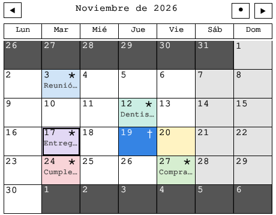
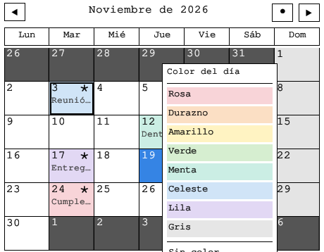
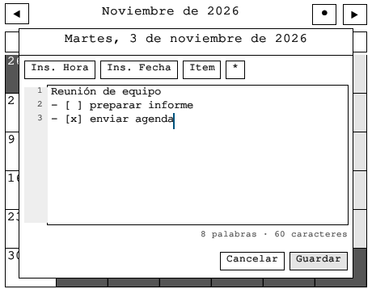

# cal3-rust

Calendario mensual con notas, escrito en Rust con
[egui/eframe](https://github.com/emilk/egui). Port de `cal3.py` (Flet), para
**Linux, Windows y Android**. Fondo blanco, tinta negra, fuente monoespaciada
y celdas en cuadrícula, como una tabla.



## Características

- Vista mensual en cuadrícula, con los días de los meses vecinos en gris
  oscuro y los sábados y domingos en gris claro.
- El día actual se resalta en azul y lleva una daga `†`.
- Cada día guarda una nota; las celdas con nota llevan una estrella `*` y
  muestran un resumen del texto.
- **Clic derecho** en un día para pintarlo con uno de 8 colores suaves
  (Rosa, Durazno, Amarillo, Verde, Menta, Celeste, Lila y Gris).
- Editor de notas con numeración de líneas, contador de palabras y botones
  para insertar hora y fecha en la línea del cursor, casillas (`- [ ]`) y un
  botón `*` que alterna `*` → `•` → `►` → sin marcador.
- Deshacer y rehacer los cambios guardados.
- Ayuda de atajos con `F1` (en Android, con el botón `?`).
- Tipografía Nimbus Mono (clon de Courier) incluida en `assets/`.

| Colores del día | Editor de notas |
| :---: | :---: |
|  |  |

## Datos

- Las notas se guardan en `calendario_notas.json`, con el mismo formato que
  la versión Python (`indent=4`, claves ordenadas, UTF-8, BOM tolerado).
- Los colores de los días se guardan aparte, en `calendario_colores.json`,
  en la misma carpeta.
- Ubicación: junto al ejecutable, o en la carpeta de la variable de entorno
  `CAL3_DATA_DIR` (o `FLET_APP_STORAGE_DATA`).
- Escritura atómica (temporal + fsync + renombrado), copia `.bak`, cuarentena
  de archivos corruptos y recarga automática si otro proceso los modifica
  (por ejemplo Syncthing).

## Atajos

| Tecla | Acción |
| --- | --- |
| `Ctrl+Z` / `Ctrl+Y` | Deshacer / rehacer |
| Flechas | Mover el día seleccionado (cambia de mes solo) |
| `Re Pág` / `Av Pág` | Mes anterior / siguiente |
| `Enter` | Abrir la nota del día |
| `T` | Volver a hoy |
| `F1` | Ayuda de atajos |
| `Ctrl+A` (editor) | Seleccionar todo el texto |
| `Ctrl+S` (editor) | Guardar sin cerrar |
| `Esc` (editor) | Guardar y cerrar |

En Android los mismos atajos funcionan con un teclado físico, y el botón
Atrás equivale a `Esc`.

## Compilar y ejecutar

```sh
cargo build --release
./target/release/cal3-rust
```

Con las notas en otra carpeta:

```sh
CAL3_DATA_DIR=/ruta/a/mis/notas ./target/release/cal3-rust
```

En Windows igual (`cargo build --release`) y obtienes
`target\release\cal3-rust.exe`. Para cruzar-compilar desde Linux
hace falta `mingw-w64`:

```sh
rustup target add x86_64-pc-windows-gnu
cargo build --release --target x86_64-pc-windows-gnu
```

## Pruebas

```sh
cargo test
```

## cfetch

Este repositorio incluye también `cfetch.py`, un script que muestra información
del sistema. Requiere `psutil` y `distro`:

```sh
python3 -m pip install psutil distro
python3 cfetch.py
```

## Android (APK)

```sh
./build_android.sh        # deja cal3-rust.apk en la carpeta del proyecto
```

Requiere `rustup target add aarch64-linux-android armv7-linux-androideabi`,
`cargo install cargo-apk --locked` y el SDK/NDK de Android en `~/Android/sdk`.
Las notas se guardan en `Android/data/com.carlosfaz.cal3rust/files/`. En el
teléfono, el clic derecho (pintar un día) es una pulsación larga.

`vendor/winit` es una copia de `winit` 0.30 con un parche para Android
(modificadores del teclado y botón Atrás); ver `vendor/winit/PATCH.md`.
